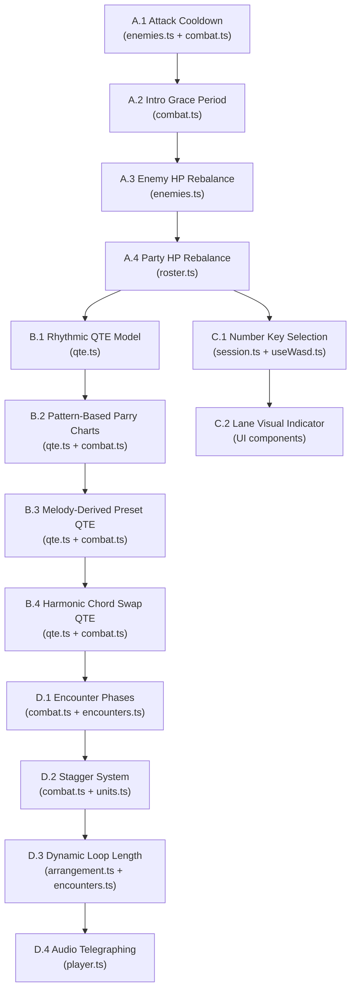

# Combat Pacing Redesign Plan

> [!IMPORTANT]
> **Goal**: Fights at 90 BPM should last **1.5–2 minutes** (~90–120 seconds), not 40 seconds. Every change below feeds that target while making combat *feel* like music.

---

## The Math Right Now (Why It's Broken)

At 90 BPM, one 16th step = `60/90/4` = **166.7 ms**. A 2-bar loop = 32 steps = **5.33 seconds**.

| Problem | Current | Why it hurts |
|---|---|---|
| **Enemy gauge fills in 1 loop** | Echo `gaugePeriod: 32` → attacks every 32 steps (5.3 s) | Player is parrying or taking chip every single loop. No breathing room. |
| **No ramp-up** | Gauges start at 0 and fill immediately from tick 1 | Combat is at full intensity from the very first beat. No "intro" phase. |
| **Enemy HP melts fast** | Echo 260 HP vs 3 attackers × 3 base × ~8 onsets/loop ≈ 72 dmg/loop + crits + poison | ~4 loops ≈ 21 seconds to kill Echo. Even doubled HP only buys ~40 s. |
| **QTE is 4 random presses in 16 ticks** | 16 ticks = 2.67 s, 4 random letters | No rhythmic shape, no musical meaning, over in a blink |
| **No number→character mapping** | Player cannot press 1/2/3 to pick performer | Forces UI click or hardcoded lead slot — breaks flow |

---

## Phase A — Engine: Attack Cadence & Ramp-Up

> Engine-only changes in [combat.ts](file:///home/honor/Documentos/antigravity/sound-angels/src/game/combat.ts) and [enemies.ts](file:///home/honor/Documentos/antigravity/sound-angels/src/data/enemies.ts). No UI, no audio.

### A.1 — Enemy Attack Cooldown (3–4 loops between strikes)

**Problem**: `gaugePeriod` is in steps and enemies attack every time it fills. At 32 steps/loop, a period of 32 means *every loop*. 

**Solution**: Add a `attackIntervalLoops` field to `EnemyProfile`. The gauge mechanic stays (it powers the parry warning), but after an enemy fires, impose a **cooldown of N full loops** before the gauge begins refilling.

```ts
// enemies.ts — new field
export interface EnemyProfile {
  // ... existing
  /** Loops of silence after an attack before the gauge starts refilling. */
  attackCooldownLoops: number  // 2–3 for balanced, 1 for horde, 3–4 for tank
}
```

| Enemy | Current gauge period | New `attackCooldownLoops` | Effective attack interval |
|---|---|---|---|
| Echo | 32 (1 loop) | 3 | ~4 loops = **21 s** |
| Mite | 24 (0.75 loops) | 2 | ~2.75 loops = **14.6 s** |
| Carapace | 48 (1.5 loops) | 3 | ~4.5 loops = **24 s** |
| Mirror | 32 (1 loop) | 3 | ~4 loops = **21 s** |
| Dust Moth | 40 (1.25 loops) | 3 | ~4.25 loops = **22.6 s** |

**Engine change in `advanceTick`**: Track per-enemy `cooldownLeft: number[]` in `AtbState`. When `cooldownLeft[i] > 0`, freeze `gauges[i]` at 0 and decrement `cooldownLeft[i]` by 1 at each loop wrap. This is pure, deterministic, serializable.

### A.2 — Combat Intro Phase (Grace Period)

**Problem**: Enemies start charging from tick 0. The player has no time to lay down even one melody before the first parry prompt.

**Solution**: Add an `introLoops` count (default 2) that acts as a global grace period at the start of combat. During intro loops:
- Enemy gauges are **frozen at 0**
- Melody damage still applies (player can start building)
- The log says something atmospheric: *"The darkness stirs but does not yet answer…"*
- After `introLoops` wraps, gauges begin filling normally

This gives the player **~10.6 seconds** (2 loops at 90 BPM) of pure creative setup before any enemy threat.

```ts
// AtbState — new fields
introLoopsLeft: number  // starts at 2, decremented at loop wrap, enemies frozen while > 0
```

### A.3 — HP Rebalance for 1.5–2 min Fights

With attacks coming every ~4 loops instead of every loop, and intro adding 2 loops, a fight needs **~18–24 loops** to last 1.5–2 min. That's ~96–128 seconds.

Target DPS (3 attackers, ~8 onsets/loop, base 3, potency fade):
- Loop 1–4: ~72 dmg/loop → ~288 total
- Loop 5–12: ~54 dmg/loop (fade) → ~432 total
- Loop 13–18: ~40 dmg/loop → ~240 total
- **Total ≈ 960 dmg over 18 loops**

Proposed HP rebalance:

| Enemy | Current HP | New HP | Shield | Reasoning |
|---|---|---|---|---|
| Echo | 260 | **480** | 0 | Tutorial enemy, pure HP soak |
| Mite | 130 | **220** | 0 | Comes in pairs (440 total), fast attacks |
| Carapace | 260 | **550** | **120** | Shield-heavy tank, needs sustained brass |
| Mirror | 160 | **350** | 0 | Mid-tier, reflect punishes sloppy play |
| Dust Moth | 180 | **400** | 0 | Track wipe forces melody replays = time |

### A.4 — Party HP Rebalance

With enemies hitting less often but fights lasting longer, party HP should rise slightly to survive ~5–6 enemy attack cycles without feeling impossible:

| Character | Current HP | New HP | Current Shield | New Shield |
|---|---|---|---|---|
| Lyra | 20 | **28** | 0 | 0 |
| Cael | 26 | **34** | 4 | **6** |
| Aria | 20 | **28** | 0 | 0 |
| Bram | 24 | **32** | 2 | **4** |
| Ignis | 20 | **28** | 0 | 0 |
| Vesper | 24 | **32** | 6 | **8** |

---

## Phase B — Rhythm-Aware QTE Highway

> Changes in [qte.ts](file:///home/honor/Documentos/antigravity/sound-angels/src/game/qte.ts), [combat.ts](file:///home/honor/Documentos/antigravity/sound-angels/src/game/combat.ts), and new UI components.

### B.1 — Rhythmic QTE Charts (Not Random Spam)

**Current problem**: `randomChart(4, rng)` generates 4 random WASD letters. No rhythm, no melody, no musical meaning. Just "press 4 random keys in 2.67 seconds."

**Solution**: QTE charts become **rhythmic phrases** — a sequence of notes placed on specific beat subdivisions within a window, synced to the transport. The player must press the right key **on the right beat**, not just in any order.

```ts
// qte.ts — new chart model
export interface QteNote {
  key: PerformKey
  /** Step offset from chart start (0-based). Determines WHEN to press. */
  stepOffset: number
  /** Timing window in steps (±tolerance). */
  window: number  // default 2 (±2 steps = ±333ms at 90 BPM)
}

export interface QteChart {
  notes: QteNote[]
  /** Total length of the chart in steps. */
  lengthSteps: number
}
```

**Chart length scales with purpose**:
- **Parry**: 1 bar (16 steps = 2.67 s) — short defensive reflex
- **Chord swap**: 2 bars (32 steps = 5.33 s) — medium, deliberate action
- **Preset recall**: 2 bars (32 steps = 5.33 s) — should mirror the phrase being recalled

### B.2 — Parry Charts from Enemy Patterns

Enemy attack patterns (`"swarm"`, `"ostinato"`, etc.) already exist but generate 4 random keys. Instead, each pattern should define a **rhythmic motif** that matches the enemy's musical character:

```ts
// Example: ostinato = steady 4-on-the-floor
const OSTINATO_CHART: QteNote[] = [
  { key: "w", stepOffset: 0,  window: 2 },
  { key: "a", stepOffset: 4,  window: 2 },
  { key: "s", stepOffset: 8,  window: 2 },
  { key: "d", stepOffset: 12, window: 2 },
]

// Example: swarm = syncopated 8th-note burst
const SWARM_CHART: QteNote[] = [
  { key: "d", stepOffset: 0,  window: 1 },
  { key: "w", stepOffset: 2,  window: 1 },
  { key: "a", stepOffset: 6,  window: 1 },
  { key: "s", stepOffset: 8,  window: 1 },
  { key: "d", stepOffset: 10, window: 1 },
  { key: "w", stepOffset: 14, window: 1 },
]
```

The parry audio layer ([player.ts](file:///home/honor/Documentos/antigravity/sound-angels/src/audio/player.ts)) can play the enemy's attack as audible notes at each `stepOffset`, so the player *hears* the rhythm they need to match. The QTE becomes a **call-and-response**: the enemy plays a phrase, the player mirrors it.

### B.3 — Preset Recall QTE Matches the Phrase

**Current**: `requestPresetQte` generates `randomChart(4, rng)`. The player presses 4 random keys having zero connection to the melody they're recalling.

**Solution**: Derive the QTE chart from the **actual melody content** of the preset/template being recalled. Sample the first N onsets from the preset's tracks, convert their scale degrees to WASD directions (degree 1→s, 2-3→a, 4-5→w, 6-7→d or similar mapping), and place them at the same rhythmic positions they occupy in the loop.

```ts
function chartFromMelody(
  tracks: (NoteEvent | null)[][][],
  maxNotes: number = 8,
): QteChart {
  // Collect onsets in playback order across all tracks
  const onsets: { stepOffset: number; degree: number }[] = []
  for (let bar = 0; bar < tracks[0].length; bar++) {
    for (let step = 0; step < tracks[0][bar].length; step++) {
      for (const track of tracks) {
        const e = track[bar]?.[step]
        if (e) onsets.push({ stepOffset: bar * 16 + step, degree: e.degree })
      }
    }
  }
  // Take first N, map degrees to WASD
  return {
    notes: onsets.slice(0, maxNotes).map(o => ({
      key: degreeToPerformKey(o.degree),
      stepOffset: o.stepOffset,
      window: 2,
    })),
    lengthSteps: tracks[0].length * 16,
  }
}
```

This way, recalling a melody **feels like playing it back**. The QTE *is* the melody.

### B.4 — Chord Swap QTE as Harmonic Gesture

For chord swap QTEs, the chart should represent the **harmonic movement** of the new progression. Map each chord's root motion to a direction:

| Root motion | Key |
|---|---|
| Up by step (e.g., i→ii) | `w` |
| Down by step (e.g., V→IV) | `s` |
| Up by skip/leap (e.g., i→IV) | `d` |
| Down by skip/leap (e.g., V→i) | `a` |

Place one note per bar position in the chart. This teaches the player to associate WASD directions with harmonic motion.

---

## Phase C — Number Keys for Character Selection

### C.1 — 1/2/3 Maps to Front-Row Positions

**Problem**: The player cannot quickly switch which character they're performing as. They need to click UI or they're stuck on the lead slot.

**Solution**: Number keys 1, 2, 3 map to `front[0]`, `front[1]`, `front[2]` respectively. Pressing a number sets the active performer to that slot's fighter.

```ts
// perform.ts or session.ts
export type NumberKey = "1" | "2" | "3"

export function selectPerformer(state: AtbState, key: NumberKey): string | null {
  const index = parseInt(key) - 1
  const id = state.slots.front[index]
  return id ?? null  // null if slot is empty
}
```

**UI**: In the combat HUD, show each front-row character card with their number badge (1, 2, 3). The active performer gets a glow/highlight. This also feeds into the "melody lanes = front positions" concept already in the engine.

### C.2 — Visual Lane Indicator

When the player presses 1/2/3, the corresponding melody lane in the loop visualizer highlights, showing which track they're recording into. This connects the spatial concept (character position) to the temporal concept (melody lane) visually.

---

## Phase D — Additional Suggestions

### D.1 — Encounter-Level Pacing Phases

Instead of just "intro then fight", structure each encounter into **musical movements**:

```
Exposition (2 loops) → Development (main combat) → Recapitulation (enemy enrage)
```

- **Exposition**: Grace period. Enemies idle. Player builds first melody. Log: *"The room hums. Something listens."*
- **Development**: Normal combat with the slower attack cadence from Phase A. This is the bulk of the fight.
- **Recapitulation**: When any enemy drops below 25% HP, they enter an "enrage" state — `attackCooldownLoops` halves, `baseAttack` increases by 50%. The fight crescendos. Log: *"The discord fractures — it fights to survive."*

This creates a **dramatic arc** that mirrors sonata form. Each fight tells a story.

### D.2 — Stagger System (Momentum Reward)

**Problem**: The player's damage output is constant regardless of how well they play. Good chord choices and clean melodies don't create exciting moments.

**Solution**: Add a **stagger gauge** to enemies. Chord-tone notes, gold-tier progressions, and clean voice-leading *build stagger*. When stagger fills:

- Enemy is **stunned for 1 loop** (no gauge fill, no attacks)
- Player damage is **doubled** for that loop
- Visual/audio: the enemy's motif breaks down into noise, the player's melody soars

This rewards musical skill with a clear power spike, creates natural high points in combat, and extends fights by giving the player control over burst windows rather than just constant DPS.

### D.3 — Dynamic Loop Length

**Current**: Always 2 bars (32 steps). This keeps fights metronomic.

**Suggestion**: Let encounters specify 4-bar loops for slower, more epic fights. At 90 BPM, a 4-bar loop = 10.67 seconds. This:

- Doubles the canvas for melody composition
- Naturally spaces out loop-wrap effects (regen, fade)
- Makes each loop feel like a proper musical phrase (4 bars = standard phrase length)
- Boss encounters could use 4 bars while early fights stay at 2

```ts
// encounters.ts
export interface EncounterDef {
  // ... existing
  bars?: number  // 2 (default) or 4
}
```

### D.4 — Enemy Telegraphing with Audio Cues

Before an enemy's gauge fills, play a **short audio motif** matching their pattern type. The player *hears* the attack building before the parry chart opens:

- **Ostinato**: Low rumbling pulse getting louder
- **Swarm**: Skittering high-pitched chirps
- **Inversion**: Descending chromatic line
- **Erasure**: White noise sweep
- **Retrograde**: Player's last melody played backwards (!)

This ties into Phase B's rhythmic QTE: the audio cue is the *question*, the QTE is the *answer*. Call-and-response is the core musical interaction.

### D.5 — Melody Recall as "Muscle Memory"

Instead of QTE charts for preset recall being a test of reflexes, make them a test of **musical memory**. Show the melody on the loop visualizer as ghost notes, and the player must play it back from memory. The closer their reproduction matches the original rhythm and pitch contour, the higher the recall quality (affecting potency refresh).

This is aspirational for V1 but plants the seed: *the game teaches you to be a better musician.*

---

## Implementation Order



> [!TIP]
> **Phases A + C are pure engine work** — no UI changes, fully testable with Vitest, and immediately improve the feel. Start here.
> 
> **Phase B** is the biggest single improvement to game feel but requires UI work (QTE highway redesign). It benefits from Phase 2.1 in the V1 plan (DDR/FNF lane) — they're the same task.
> 
> **Phase D** suggestions are additive — each one independently improves combat and none blocks the others.

---

## Expected Fight Duration After Changes

| Scenario | Loops | Time at 90 BPM | Notes |
|---|---|---|---|
| Echo solo (tutorial) | 16–20 | **85–107 s** | ✅ Target range |
| Mite swarm (2×) | 18–22 | **96–117 s** | Faster attacks but less total HP |
| Shield & Mirror | 20–24 | **107–128 s** | Shield absorbs early DPS |
| Discordant Choir (boss) | 24–28 | **128–149 s** | Track wipes + reflect extend fight |

> [!NOTE]
> All estimates assume the default 3-striker party with the seeded default melody, normal potency fade, and no stagger system. Stagger (D.2) would create variance: well-played fights finish faster, sloppy fights drag. That's good — *skill expression is duration expression*.
