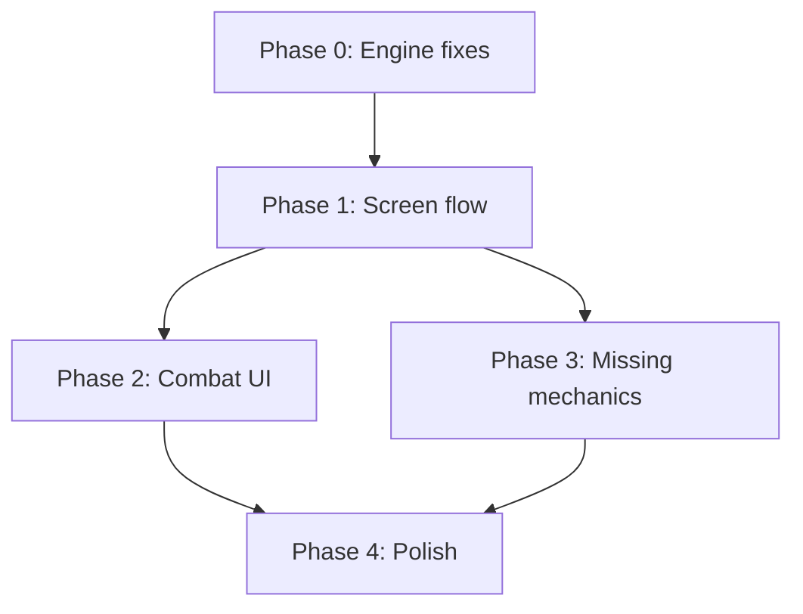

# Sound Angels — V1 Audit & Plan

## Part 1: Mechanics Doc vs Reality

Comparing every claim in [mechanics.md](file:///home/honor/Documentos/antigravity/sound-angels/docs/mechanics.md) against the actual codebase.

### ✅ What matches

| Mechanic | Doc says | Code does |
|---|---|---|
| **ATB System** | Active Time Battle | `combat.ts` — ATB gauges fill per tick, enemies fire at 100 |
| **Stats** | HP / Shield / Buffs | `Fighter` has `hp`, `shield`, `buffs[]` (poison, regen, exposed, warded) |
| **Key locked per fight** | "Defined at beginning of fight" | `beginFight` copies key → `fight.key`, locked during play |
| **Chord presets** | Pre-made progressions | 7 `CHORD_PRESETS` in `chords.ts`, selectable via `ChordWheel` |
| **Chord effects** | "Create some kind of effect" | `chordEffectFor()` → gold/silver/bronze → regen, ward, bonus damage |
| **Chord quality scoring** | Voice-leading, diatonic fit, harmonic syntax | `theory.ts`: `voiceLeadingScore`, `diatonicFitScore`, `syntaxScore` — all 3 metrics |
| **Loop station** | Notes recorded at playhead position | `performDown` writes onset at current `globalStep` position |
| **Multi-character stacking** | Multiple instruments on separate loops | 3 attacker lanes (front slots), each with own track |
| **Melody fade** | "Effect of recorded melodies fade" | Potency fades ×0.75 per loop wrap, floor 0.25 |
| **Presets / Cooldowns** | Save & recall with cooldown, duplicate detection | `presets.ts` — hash-based duplication, cooldown = `loopLen*2 + ceil(onsets/8)` |
| **Positions** | Chord maker / Attacker / Defender (beat) | `Slots { chord, beat, front[] }` — 3 roles |
| **Long vs short notes** | Auto-detect long press → extended note | `pressToLen()` quantizes hold duration → 1/2/4/8 steps |
| **Horde vs tank meta** | Short notes for hordes, long for tanks | Horde archetype: 45% dodge on long notes; Tank: slower gauge |
| **Enemy weaknesses** | "Weak/resistant against instruments, elements" | `EnemyProfile.weaknesses/resists` — instrument + element arrays |
| **Reflect variants** | "Reflect damage of nonchord/long/short notes" | `reflect?: ReflectMode` on enemies (nonchord, long, short) |
| **Track wipe** | "Deletes your tracks" | `trackWipe?: boolean` on Dust Moth → `clearTracks()` |
| **Enemy attack patterns** | Arpeggios as QTE | `chartFromPattern()` — swarm, ostinato, inversion, erasure, retrograde |
| **Chip damage** | "Most deal at least a fraction" | `chipFraction` per enemy (0.25–0.5) |
| **WASD recording** | "Playing notes with WASD" | `useWasd` hook → `performDown`/`performUp` → note at playhead |
| **QTE for chord swap** | "Quick time event to change chords mid-fight" | `requestChordQte` opens 16-tick WASD chart |
| **QTE for preset recall** | "Quick time event for pre-made melodies" | `requestPresetQte` opens 16-tick chart |
| **Enemy parry** | "FNF-style with WASD to block" | Parry QTE opens at gauge ≥ 75%, score reduces damage |

---

### ⚠️ Partially implemented / Mismatched

| Mechanic | Doc says | Reality | Gap |
|---|---|---|---|
| **Custom chord crafting** | "In advanced modes, player can unlock crafting of any chord progression" | Only 7 hardcoded presets + per-bar roman selectors in StepGrid. No "craft mode" unlock or free-form progression builder | **Missing feature** — needs a custom chord builder with the existing scoring pipeline |
| **Pre-fight melody recording** | "Player can record melodies pre-fight. To cast in battle, perform a QTE" | The grid is editable pre-fight but there's no distinct "pre-fight melody bank." Presets can only be saved *during* a fight (they track `fight.tick` for cooldown). Pre-fight grid edits are just the starting arrangement | **Partial** — need a pre-fight melody library separate from runtime presets |
| **Beat keeper parry** | "Defender builds beats, parries enemy attacks with QTE where keys don't match actual key — maps arpeggio" | Beat keeper exists. `beatDegreeFor()` maps presses to chord-fitting arpeggios. But parry QTE is generic WASD matching, not beat-specific | **Partial** — the arpeggio mapping exists in `qte.ts` but parry QTE doesn't use it differently for beat keepers |
| **Random target selection** | "Multiple enemies → note attacks select random targets" | `advanceTick` picks `enemies[floor(rng() * alive)]` — works | ✅ Correct |
| **Chord mid-swap blocking** | "Can't do other tasks while swapping chords" | `qteLocked()` blocks loop recording during QTE | ✅ Correct — but doc implies more friction (can't even move fighters, etc.) |
| **Long note evasion** | "Enemies have more probabilities to evade long notes" | Horde archetype: 45% dodge on `len ≥ LONG_LEN`. But ALL archetypes treat short notes the same (5% base evasion) | **Close enough** — could tune per-archetype |

---

### ❌ Missing or broken

| Mechanic | Doc says | Reality |
|---|---|---|
| **Unlockable characters** | "1 to 3 characters per instrument" — characters as collectible entities with unique stats | Only 3 generic fighters with fixed instruments (strings/piano/brass). No character identity, names, portraits, unlock system, or character roster |
| **Multiple enemies per fight** | Implied by "multiple enemies at the same time" | `createFight` supports `enemyIds[]` but UI (`TransportBar`) always starts with the default single "echo" enemy. No encounter builder or wave system |
| **Screen layout** | "Left: enemies. Center: loop grid + chord wheel + DDR panel. Right: player characters as cards" | Layout roughly matches but execution is poor (see UI section below) |
| **Card-based characters** | "All characters are cards" with visual card presentation | Fighters are draggable rectangles with minimal info. No card art, no card metaphor |
| **DDR-style panel** | Prominent "DDR-style or Piano Roll" for blocking and casting | QtePanel is a tiny row of letter buttons at the bottom. Not a full DDR/FNF lane |
| **Instrument variety** | "Player can carry multiple characters, each with a different weapon" — implies many instruments | Only 3 instruments exist. Doc implies an expanding roster |
| **Element system depth** | Weakness/resistance to elements and effects | Elements exist (keen, bright, heavy) but there's no UI explanation of what they mean, no element icons, no rock-paper-scissors visual |

---

## Part 2: UI Problems

The current UI is functional but reads like a debug panel, not a game.

### Critical issues

1. **No game flow** — No start screen, no character select, no win/lose screen, no transition between states. Everything is crammed onto one page. The player has no sense of progression or stakes.

2. **The grid is confusing** — `StepGrid` tries to be both a sequencer and a combat interface. Numbered degree cells (1–7) with dot-length annotations are not intuitive. There's no visual connection between "press W" and "note appears on grid."

3. **QTE is invisible** — The most action-packed mechanic (parry, chord swap, preset recall) is a tiny row of `w a s d` buttons at the bottom. It should be a full-screen overlay like FNF/DDR with scrolling arrows and timing feedback.

4. **No visual feedback for combat** — Damage dealt, crits, evasions, reflects — all of these are only in the combat log text. No hit flashes, screen shakes, number popups, or visual effects.

5. **Party management is awkward** — Drag-and-drop cards is fine for pre-fight setup but the cards are tiny rectangles. No character art, no instrument icons, no visual personality.

6. **Chord wheel is cramped** — 7 buttons in a 224px circle is hard to read and click, especially on smaller screens. The tier/effect info is buried in tooltips.

7. **No tutorial or onboarding** — The game drops you into a fully assembled combat with no explanation. The dark-room flavour text ("A dark room. A faint hum.") doesn't teach mechanics.

8. **Single-column mobile collapse** — The 3-column layout collapses to a single scroll on mobile, which makes WASD gameplay impossible (keyboard-only). No touch input alternative.

---

## Part 3: V1 Roadmap

> [!IMPORTANT]
> V1 = **a complete, playable combat loop** that someone can pick up, understand, enjoy, and want to replay. Not the full meta-game with unlocks and progression.

### Phase 0 — Foundation fixes (Engine)
*Things that are broken or wrong in the engine that block a good V1*

- [x] **0.1 — Multi-enemy encounters**: Wire up encounter selection. `startFight` accepts an encounter template or enemyIds. Added 5 curated encounters of escalating difficulty (`src/data/encounters.ts`).
- [x] **0.2 — Win/lose state machine**: Added `GamePhase` model (`src/game/phase.ts`): `menu → prep → combat → victory → defeat`. Integrated state transitions into `session.ts` and `advanceTick`.
- [x] **0.3 — Pre-fight melody bank**: Created persistent `melodyBank.ts` with 3 curated starter templates, saving/deleting, loading into grid during prep, casting mid-combat via QTE, and resetPresetCooldowns for clean combat restarts.

### Phase 1 — Screen flow & game feel
*Replace the single-page dump with actual screens*

- [x] **1.1 — Title / Menu screen**: Created atmospheric `MenuScreen.tsx` with Dark Room aesthetic, interactive Web Audio awakening, live WASD audition preview, and trial target selection.
- [x] **1.2 — Prep screen**: Created `PrepScreen.tsx` with `EncounterBanner`, `MelodyBankBar`, harmonic progression tuning, key & BPM controls, party formation, and "Engage Combat" action.
- [x] **1.3 — Combat screen**: Created `CombatScreen.tsx` with focused 3-column battle layout (Enemies, Loop & QTE, Party), locked combat parameters, and retreat action.
- [x] **1.4 — Victory / Defeat overlay**: Created `ResultOverlay.tsx` with duration stats, harmonic craft evaluation, encounter tips, "Next Encounter" advancement, retry, and return to prep.

### Phase 2 — Combat UI redesign
*Make combat feel like a game, not a spreadsheet*

- [ ] **2.1 — Full DDR/FNF QTE lane**: Scrolling arrows moving toward a hit zone. Timing-based scoring (perfect/great/miss). Use the full center area when a QTE is active. This is the #1 missing piece for game feel.
- [ ] **2.2 — Live loop visualizer**: Replace the static numbered grid with a circular or horizontal scrolling visualizer. The playhead should sweep across, notes should glow and pulse when they fire, damage numbers should pop off them.
- [ ] **2.3 — Enemy cards with personality**: Give each enemy a visual identity. Animated idle state (subtle CSS animation). Hit flash on damage. Shake on attack. Death animation.
- [ ] **2.4 — Party cards with personality**: Character portraits (can be simple illustrated cards). Instrument icons. HP bar should feel weighty. Show the performing character enlarged/highlighted.
- [ ] **2.5 — Combat feedback layer**: Floating damage numbers. Crit flash. Evasion "miss" text. Shield break effect. Buff/debuff icons with tooltips. Screen edge flash on player damage.
- [ ] **2.6 — Chord effect visuals**: When chord blessing triggers (loop wrap), show a visual pulse. Gold tier = warm glow. Silver = cool shimmer. Bronze = dim.

### Phase 3 — Missing mechanics
*Features in the doc that aren't built yet*

- [ ] **3.1 — Custom chord builder**: Let the player drag roman numerals into a 4-slot progression. Show live scoring (voice-leading / diatonic fit / syntax) as they build. Lock behind a "crafting unlocked" flag for now.
- [ ] **3.2 — Encounter system**: 5–8 curated fights with escalating difficulty and different enemy compositions. A simple linear progression: fight 1 = echo, fight 2 = 2× mite, fight 3 = carapace, etc. Final fight = multi-wave.
- [ ] **3.3 — Character roster**: Expand from 3 generic fighters to 3–5 named characters with distinct stats, passives, and visual identity. Keep the same 3 instruments for V1 but characters have stat variations (one violinist with high crit, another with high HP).

### Phase 4 — Polish
*What makes V1 feel finished*

- [ ] **4.1 — Sound design**: Victory jingle. Defeat sting. UI click sounds. QTE hit/miss sounds. Chord change transition sound.
- [ ] **4.2 — Tutorial / First fight**: Guided first encounter. Teach WASD recording, QTE parry, chord selection, fighter positioning — one concept per fight beat.
- [ ] **4.3 — Difficulty pacing**: Tune enemy HP, gauge speed, attack damage so the 5–8 fight sequence feels like a smooth difficulty curve.
- [ ] **4.4 — Persistent state**: LocalStorage save for encounter progress, unlocked presets, and character roster.
- [ ] **4.5 — Accessibility**: Keyboard focus management. Screen reader announcements for combat events. Color-blind safe palette for tiers.

---

## Dependency graph

## Priority order for maximum impact

1. **Phase 1.1–1.4** (screen flow) — biggest bang. Turns the app from a debug tool into a game with a beginning, middle, and end.
2. **Phase 2.1** (DDR/FNF QTE) — this is the core "fun" of the game. Without a real QTE lane, parry and chord swap feel like clicking buttons.
3. **Phase 2.2–2.5** (visual feedback) — makes combat *feel* impactful.
4. **Phase 0.1–0.2** (multi-enemy + state machine) — needed for any encounter progression.
5. **Phase 3.2** (encounter system) — gives the player a reason to keep playing.
6. Everything else — polish, custom chords, character roster.

> [!TIP]
> The engine is solid. `combat.ts`, `theory.ts`, `arrangement.ts`, `qte.ts` — all well-structured, well-tested, and match the design doc closely. The gap is almost entirely in the **UI/UX layer**. The bones are there; the skin is missing.
